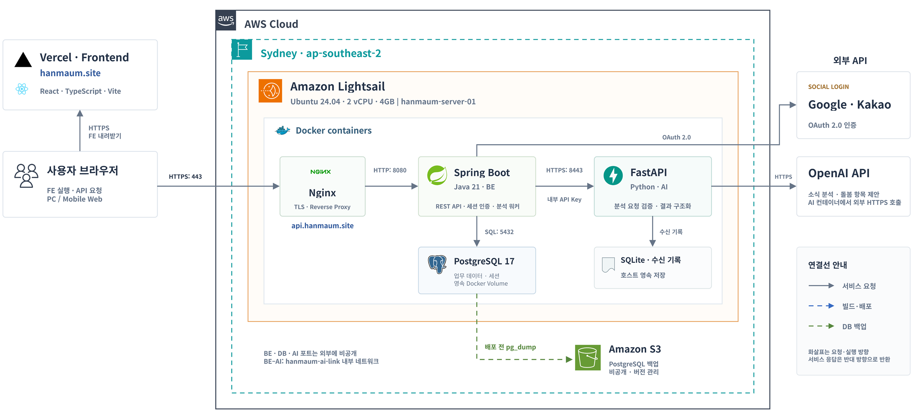
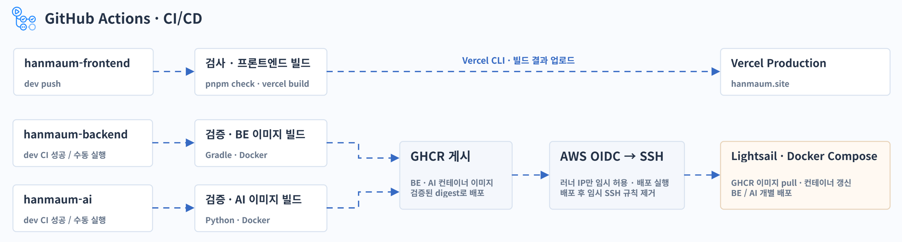
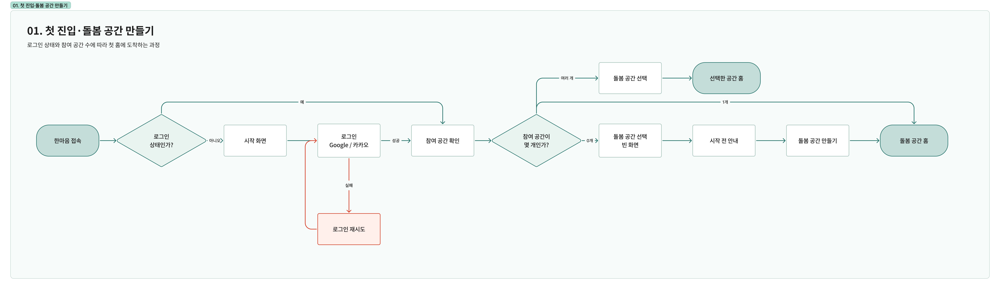
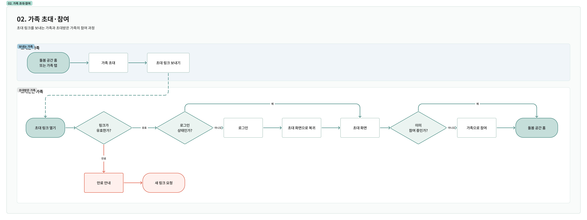
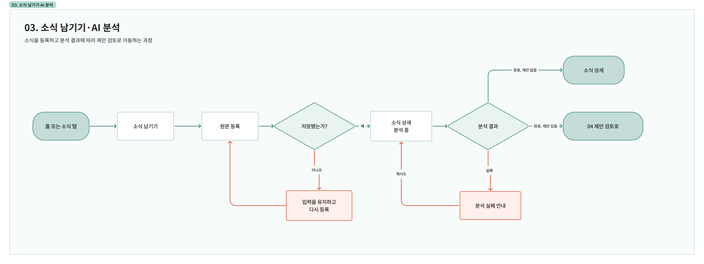

# 한마음 프로젝트 문서

한마음은 가족이 부모님의 돌봄 소식을 함께 기록하고 필요한 일정을 챙기는 웹앱입니다. AI가 소식을 분석해 일정·할 일·확인사항을 제안하면, 가족이 검토하고 공간 소유자가 반영을 확정합니다.

`hanmaum-docs`는 한마음의 프로젝트 기획서, 기능 명세서, 제품 정책서와 FE·BE·AI 공통 개발 문서를 관리하는 저장소입니다.

## 문서 바로가기

### 제품 문서

- [프로젝트 기획서](product/project-plan.md)
- [기능 명세서](product/feature-spec.md)
- [제품 정책서](product/product-policy.md)
- [정보 구조도(IA)](product/ia.md)
- [유저 플로우](product/user-flow.md)

### 공통 개발 문서

- [시스템 아키텍처](development/architecture.md)
- [CI/CD](development/ci-cd.md)
- [개발 워크플로우](development/workflow.md)
- [API 안내](development/api.md)

## 주요 다이어그램

### 정보 구조도(IA)


### 시스템 아키텍처



### CI/CD



### 유저 플로우 4장

**01. 첫 진입·돌봄 공간 만들기**



**02. 가족 초대·참여**



**03. 소식 남기기·AI 분석**



**04. 제안 검토·반영**


## 📁 폴더 구조

```text
hanmaum-docs/
├── README.md
├── product/                         # 프로젝트 기획서, 기능 명세서, 제품 정책서, IA, 유저 플로우
│   ├── project-plan.md
│   ├── feature-spec.md
│   ├── product-policy.md
│   ├── ia.md
│   └── user-flow.md
├── development/                     # 시스템 아키텍처, CI/CD, 개발 워크플로우, API 안내
│   ├── architecture.md
│   ├── ci-cd.md
│   ├── workflow.md
│   └── api.md
├── reports/                         # 졸업작품 결과보고서 원본 및 제출용 PDF
│   └── .gitkeep
├── presentation/                    # 졸업작품 포스터 및 발표 자료
│   └── .gitkeep
└── assets/                          # 문서에서 함께 사용하는 그림과 도표
    ├── development/
    │   ├── ci-cd.png
    │   └── system-architecture.png
    ├── information-architecture/
    │   └── Information Architecture.png
    └── userflow/
        ├── 01-userflow.png
        ├── 02-userflow.png
        ├── 03-userflow.png
        └── 04-userflow.png
```
