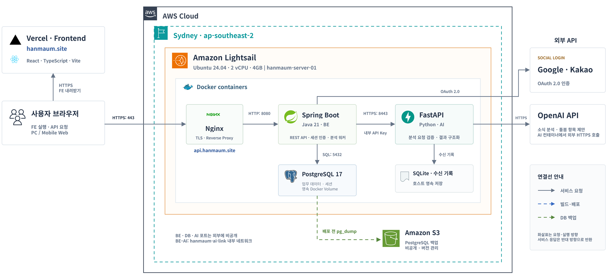

# 한마음 시스템 아키텍처

사용자 브라우저는 Vercel에서 프론트엔드를 받아 실행한다. AWS Lightsail의 Nginx는 브라우저의 API 요청을 Spring Boot 백엔드로 전달한다. 백엔드는 Google·카카오 로그인과 세션 인증을 처리하고, 돌봄 데이터와 세션을 PostgreSQL에 저장한다.

백엔드는 돌봄 소식 분석을 FastAPI에 내부 HTTPS로 요청한다. AI 서비스는 OpenAI API로 소식을 분석해 돌봄 항목 제안을 구조화하고, 요청 수신 기록은 SQLite에 저장한다. 배포 전 PostgreSQL 백업은 Amazon S3에 보관한다.
