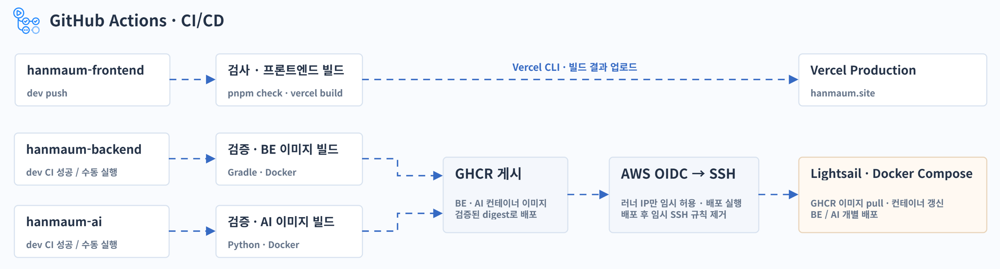

# 한마음 CI/CD

프론트엔드는 `dev` 브랜치에 푸시하면 GitHub Actions에서 검사와 빌드를 수행하고, 빌드 결과를 Vercel 운영 환경에 배포한다.

백엔드와 AI는 `dev` 브랜치의 CI가 성공하면 자동으로 배포를 시작한다. 두 서비스 모두 워크플로를 수동으로 실행해 배포할 수도 있다. 두 워크플로는 각각 검증과 Docker 이미지 빌드를 수행한 뒤 이미지를 GitHub Container Registry(GHCR)에 게시한다.

워크플로는 AWS OIDC로 인증하고 러너 IP의 SSH 접속을 임시로 허용한다. Lightsail에서는 Docker Compose로 검증된 이미지 다이제스트를 사용해 해당 컨테이너를 갱신한다. 배포 후에는 임시 SSH 규칙을 제거한다.
