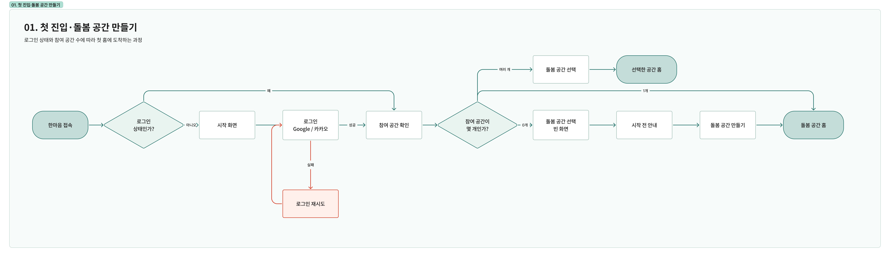
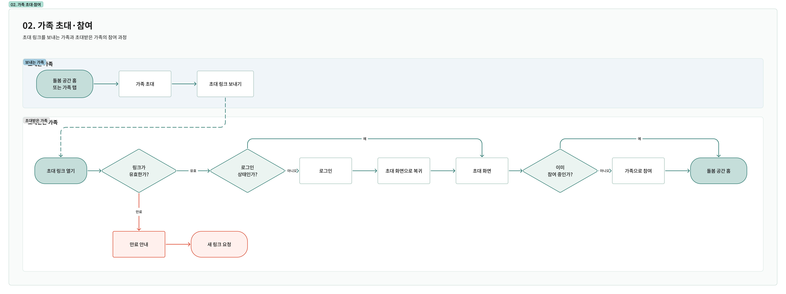
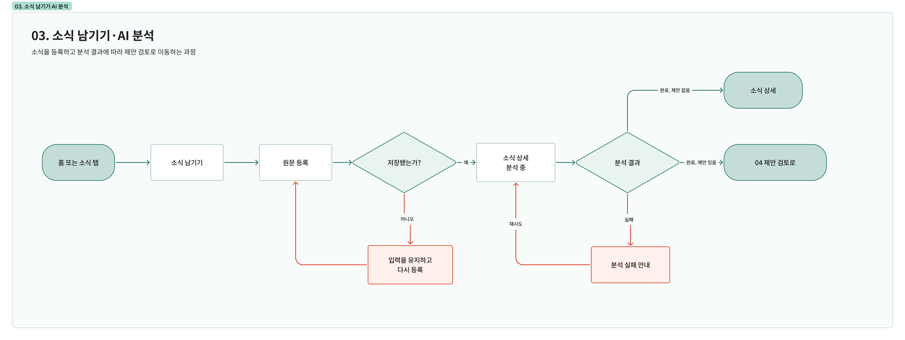

# 한마음 유저 플로우

## 01. 첫 진입·돌봄 공간 만들기

로그인이 필요하면 Google이나 카카오로 로그인한 뒤 참여 중인 돌봄 공간을 확인한다. 참여 공간이 없으면 시작 전 안내를 거쳐 새 공간을 만들고, 하나면 해당 공간의 홈으로 바로 이동하며, 여러 개면 들어갈 공간을 선택한다.

## 02. 가족 초대·참여

돌봄 공간 홈이나 가족 탭에서 초대 링크를 보낸다. 초대받은 가족은 유효한 링크를 열고 필요하면 로그인한 뒤 공간에 참여한다. 이미 참여 중이면 공간 홈으로 이동하고, 링크가 만료되면 새 링크를 요청한다.

## 03. 소식 남기기·AI 분석

홈이나 소식 탭에서 원문을 등록하고 소식 상세에서 AI 분석 상태를 확인한다. 저장에 실패하면 입력을 유지한 채 다시 등록하고, 분석에 실패하면 분석을 재시도한다. 분석이 끝나면 소식 상세에서 결과를 확인하고, 제안이 있으면 제안 검토로 이동한다.

## 04. 제안 검토·반영

‘확인할 내용’이나 소식 상세에서 제안의 근거를 비교하고 필요하면 내용을 수정한다. 연결할 기존 항목이 모호하면 후보를 비교해 대상을 고르고, 적절한 후보가 없으면 제안을 보류한다.

구성원은 반영을 요청하고, 소유자는 요청을 검토하거나 직접 선택한 제안을 확인한다. 검증을 통과하면 돌봄 현황에 반영하고, 충돌이 있으면 제안을 다시 검토한다. 소유자가 미적용을 결정하면 기존 돌봄 정보를 유지한다.
